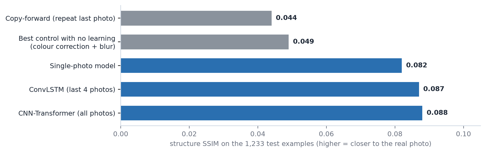
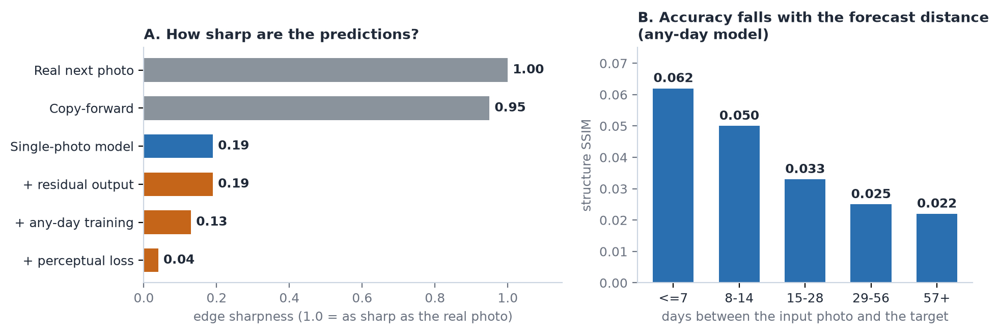

# Forecasting cauliflower growth from drone images (GrowliFlower)

Given a plant's earlier UAV photos, how well can a model forecast how it will develop? This project answers two versions of that question on the
[GrowliFlower](https://huggingface.co/datasets/Voxel51/GrowliFlower) dataset (739 plants, two fields), always with a plant-wise train / validation / test split
(518 / 111 / 110 plants, no plant in two splits) and always against baselines that use no learning.

| Track | Question | Verdict |
|---|---|---|
| **1. Diameter forecasting** | Predict a plant's next diameter from its photo history | Beats persistence by 43% (MAE 5.13 vs 9.07, label units), but a simple seasonal-growth baseline that uses the last measurement is better still (4.74); see Caveats |
| **2. Next-photo prediction** | Generate a plant's next photo from its earlier photos | Works modestly: about 2x the structure score of repeating the last photo, but the output is blurry; three sharpening attempts failed |

## Results at a glance

**Track 1, diameter (110 test plants, 1,057 examples; MAE and RMSE in the dataset's label units, lower is better; see the units caveat below):**

| Method | MAE | RMSE |
|---|---|---|
| Persistence (assume no change) | 9.07 | 10.91 |
| Age-only growth curve (no images, no measurements) | 6.63 | 9.71 |
| Last measurement + mean growth for that step (no images) | 4.74 | 7.20 |
| Single photo, ridge regression on frozen ResNet18 features | 5.91 | 8.66 |
| CNN-Transformer | 5.53 | 8.67 |
| **CNN-LSTM** | **5.13** | **8.06** |

**Track 2, next photo (110 test plants, 1,233 examples; higher is better):**

| Method | Structure SSIM | RGB SSIM | PSNR (dB) |
|---|---|---|---|
| Copy-forward (repeat the last photo) | 0.044 | 0.122 | 10.04 |
| Best control with no learning (colour correction + blur) | 0.049 | 0.217 | 14.40 |
| Single-photo model | 0.082 | 0.254 | 14.84 |
| ConvLSTM, last 4 photos | 0.087 | 0.258 | 14.87 |
| **CNN-Transformer, all photos** | **0.088** | **0.259** | **14.96** |



Structure SSIM (luma with local contrast normalisation) is the primary metric: RGB SSIM and PSNR are largely reproduced by the no-learning control (72% and 91% of
the models' gain) while only 13% of the structure SSIM gain is. Details and definitions: [docs/02](docs/02-image-track-data-and-baselines.md).

## What we learned

- **Diameter: photos and dates help, but the simplest strong baseline is not beaten.** The CNN-LSTM beats the single-photo model by 13% MAE and persistence by 43%, and the Transformer lost to the LSTM. But an age-only curve already removes 27% of persistence's error, and persistence plus average seasonal growth (which uses the last measurement, an input the models do not receive) scores 4.74, better than the LSTM's 5.13.
- **The next-photo gain is real but small.** It survives the controls, generalises to unseen plants (training plants 0.098 to 0.102 vs test 0.087 to 0.088), and is
  far above the run-to-run noise (about 0.0008 for a difference of two single runs).
- **More history adds only a little** (+0.002 ConvLSTM, +0.005 Transformer), concentrated in early-season Field2 photos. A swapped-history test shows this gain depends on the
  plant's own earlier photos (+0.016 becomes -0.031 with another plant's photos), and that the model is fragile to inconsistent history.
- **The pictures are blurry and cheap fixes do not help.** A residual output, a VGG perceptual loss and any-day training were each tested; none sharpened the output and the
  perceptual loss made it flatter. Even real consecutive photos differ in leaf layout (copy-forward scores only 0.044), so a loss that matches the one real future photo is
  minimised by an average. Sharp output would need adversarial or diffusion training, which gives plausible rather than accurate leaves.



## Demo

A Streamlit app runs the frozen image models on held-out plants on a laptop CPU (pick a plant, how many earlier photos to use, and optionally drop some photos).
It needs a small bundle exported from the cluster; see [DEMO.md](DEMO.md).

```bash
pip install -r requirements-demo.txt
streamlit run app.py
```

## Repository layout

```
src/            pipeline, models, training, evaluation and diagnostic scripts
scripts/        SLURM job scripts (Swan, UNL's HPC cluster) and helpers
docs/           the full write-up, split by topic (see below)
app.py          Streamlit demo (+ src/demo_core.py)
data/ outputs/ checkpoints/   generated artifacts (gitignored; recreate with the scripts)
```

Heavy work (anything touching the images or a GPU) runs on Swan; the laptop is used for metadata work, analysis and the demo. Environment setup and the
pipeline commands, in order, are in [docs/00](docs/00-dataset-and-setup.md) and [docs/01](docs/01-diameter-forecasting.md).

## Documentation

| File | Contents |
|---|---|
| [docs/00-dataset-and-setup.md](docs/00-dataset-and-setup.md) | Dataset, license caveat, repository structure, environment setup |
| [docs/01-diameter-forecasting.md](docs/01-diameter-forecasting.md) | Track 1: task, pipeline, baselines, CNN-LSTM and CNN-Transformer sweeps, robustness to missing photos, limitations |
| [docs/02-image-track-data-and-baselines.md](docs/02-image-track-data-and-baselines.md) | Track 2: pairs, split, data-quality exclusions, evaluation protocol, copy-forward baseline, colour-match oracle, single-photo model |
| [docs/03-image-track-controls-and-models.md](docs/03-image-track-controls-and-models.md) | No-learning controls, ConvLSTM (K=1, K=4, seeds), CNN-Transformer with single-photo control, early-season Field2 follow-ups |
| [docs/04-image-track-diagnostics.md](docs/04-image-track-diagnostics.md) | Sharpening ablation (negative result), memorisation check |
| [docs/05-reproducibility.md](docs/05-reproducibility.md) | From-scratch reproduction, noise estimates, run-to-run nondeterminism test, 42-quantity comparison |
| [docs/status-history.md](docs/status-history.md) | The original introduction and status log |

## Caveats

- **Diameter units are unverified.** Neither the dataset paper nor the dataset card states a unit for the diameter labels (values 1 to 118, median 53); "mm" was an assumption and the labels may be centimetres.
- **The split is by plant, not by plot.** All 9 plots contain both training and test plants, while the dataset paper proposes spatially disjoint splits. Results describe new plants within the observed plots, fields and seasons; a held-out-plot evaluation has not been run.
- **Image models are not linked to biological traits.** Higher SSIM has not been shown to give better diameter, canopy or growth-stage estimates; the two tracks are evaluated separately.
- **Cause of the blur is not isolated.** Unpredictable leaf layout is the working explanation; misregistration between consecutive photos (the paper reports shifts of up to about 10 cm between head and stem position early in growth) may contribute and has not been measured.

## Status and next steps

Track 1 (diameter) is complete. Track 2 (next photo) is complete through the sharpening ablation. Open decision: make measurement forecasting the headline result
(finish multi-trait forecasting: height, head diameter, growth stage, with prediction ranges), and/or try a time-boxed adversarial-loss attempt or a canopy-mask forecast
for visual output. Open follow-ups noted in the docs: whether the swapped-history dependence holds beyond early-season Field2, and what in the earlier photos the
Transformer uses.

## Data and license

Kierdorf, J., Junker-Frohn, L. V., Delaney, M., Olave, M. D., Burkart, A., Jaenicke, H., Muller, O., Rascher, U., & Roscher, R. (2022). *GrowliFlower: An image time series
dataset for GROWth analysis of cauLIFLOWER.* arXiv:2204.00294.

**License caveat (unresolved):** no license is stated in the PhenoRoam catalog record, the dataset card or the paper. Confirm with the corresponding author before any wider
sharing or publication. For this reason **no dataset photos are committed** to this repository (only charts and diagrams in `docs/img/`).
